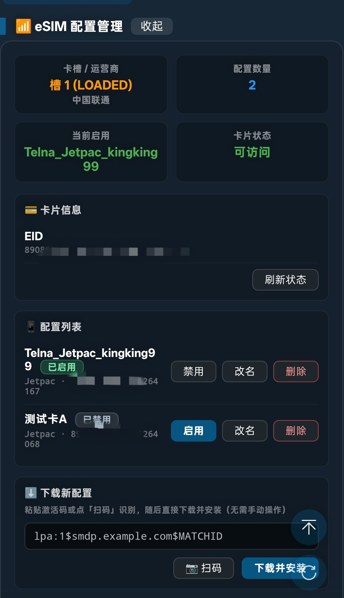

# Lino eUICC Control

面向联发科/展锐 UFI（MiFi）设备的一体化 eSIM 管理方案：**ufitools 插件 + Magisk 模块**。

插件提供图形界面，模块以特权身份直连 eUICC（OMAPI + ES10c）并复用 OpenEUICC 的
`liblpac-jni.so` 完成 ES9+ 下载。全部操作经 root shell 下发，**不做 UI 自动化**，
不受屏幕旋转/锁屏影响。

<p align="center">
  
</p>

<p align="center"><i>插件界面：卡槽与运营商、配置数量、当前启用项、卡片可访问性；每个配置支持启用/禁用、改名、删除；底部为扫码或粘贴激活码后一键下载。</i></p>

## 功能

| 功能 | 实现通道 | 状态 |
|---|---|---|
| 配置列表（ICCID / 昵称 / 提供商 / 状态） | OMAPI + ES10c `BF2D` | ✅ 实测通过 |
| 启用 / 切换配置 | ES10c `BF31` | ✅ 实测通过 |
| 禁用配置 | ES10c `BF32` | ✅ 实测通过 |
| 删除配置（ICCID 二次确认） | ES10c `BF33` | ⚠️ 拦截逻辑已验证，实际删除未执行 |
| 自定义名称（改名 / 清除） | lpac `es10cSetNickname` | ✅ 实测通过 |
| 下载并安装配置（无 UI） | lpac ES9+ | ✅ 实测通过 |
| 扫码填入激活码 | 本地 jsQR 解码（**按需下载**） | ✅ 离线验证通过 |
| 卡槽识别 / 双卡槽位选择 | OMAPI reader 名映射 | ✅ 双卡双 eUICC 实测通过 |

## 目录结构

```
plugin/            ufitools 插件（拖入即用）
  Lino-euicc-control_v1.6.js    最新
  Lino-euicc-control_v1.2.js    ...
module/
  src/             特权 APK 源码（Java）
  build-files/     Magisk 模块骨架（module.prop / service.sh / 白名单）
  releases/        可直接刷入的模块 zip
docs/              开发过程中的技术分析
third_party/       jsQR 解码器（扫码功能按需下载的源文件）
```

## 安装

1. **先刷模块并重启**（插件依赖它）
   ```
   module/releases/Lino-euicc-control-vX.Y.zip  →  Magisk 刷入 → 重启
   ```
2. **再装插件**：把 `plugin/Lino-euicc-control_vX.Y.js` 拖入 ufitools

重启后用 `pm path kano.euiccctl` 确认应用位于 `/system/priv-app/`。

### 扫码组件（可选）

插件 v1.7 起**不再内嵌** jsQR 解码器（原占 251 KB），扫码功能改为按需下载：

- 在插件「下载新配置」区底部点击 **「下载扫码组件」**（约 251 KB，仅需一次）
- 组件存于 `/sdcard/ufitools/lib/jsQR.min.js`，不想要时点 **「卸载」** 释放空间
- 下载后校验 sha256；也可手动下载后放入该路径

```
sha256  bc40c8a15196236b2314db0856f72ca0b49980cd5413b8c852a7349f5fee0859
```

该组件来自 [cozmo/jsQR](https://github.com/cozmo/jsQR)（Apache-2.0）。

## 技术要点

### 为何用特权 APK 而非纯命令行

设备的 eUICC 是**可插拔实体 eSIM**（框架视为 `isEmbedded=false`），导致：
- `EuiccCardManager` 的写接口返回 `-3`（`RESULT_INVALID_EID`）
- 从 `app_process` 调 OMAPI 报 `SecurityException`（缺应用身份）

因此需要一个 priv-app，配合 `privapp_whitelist` 授予
`WRITE_EMBEDDED_SUBSCRIPTIONS` / `SECURE_ELEMENT_PRIVILEGED_OPERATION` 等权限。

### 为何下载要复用 lpac

系统 `EuiccService`（由 OpenEUICC 提供）**未实现** `onDownloadSubscription`
（上游源码即如此），调用只会得到 `UnsupportedOperationException`。
其下载向导 `DownloadWizardActivity` 存在竞态缺陷（见 docs），外部唤起不稳定。

故直接驱动 `liblpac-jni.so`：
```
liblpac-jni.so  NEEDED 仅 libc/libm/libdl（TLS 静态链接），141 个 JNI 导出
createContext(isdrAid, apduInterface, httpInterface) → long
downloadProfile(handle, address, matchingId, imei, confirmationCode, callback) → int
```
lpac 以依赖注入方式设计 —— C 库负责 SGP.22 协议，**APDU 与 HTTP 通道由调用方提供**。
本项目实现 `LpacApdu`（OMAPI）与 `LpacHttp`（HTTPS）两个桥接即可复用完整 ES9+。

### 踩过的坑（源码中均有注释）

- Kotlin `object` 的 `external fun` 编译为**实例方法**，反射须经 `INSTANCE` 字段传单例，
  否则 `NullPointerException: null receiver`
- 原生库与 ClassLoader 强绑定，`.so` 一旦被某个 loader 打开就不能再被另一个加载；
  loader 必须进程内单例
- SM-DP+ 使用 GSMA RSP2 专属 PKI（不在公共信任库），且
  **`HttpsURLConnection` 装自定义 SSLSocketFactory 后会被服务器拒绝（HTTP 500）**，
  改用 `SSLSocket` 手写 HTTP 才通
- ES10c 的 `EnableProfile` 报文里 `refreshFlag(81)` 必须在 `A0` **之外**
- OMAPI 的 `SEService` 必须 `shutdown()`，否则同进程二次使用报 `null receiver`

## 双卡场景实测记录

在两张 eUICC 同时插入的情况下验证过（此前只有单卡）：

```
PHONE_COUNT=2
SUB_SLOT=0;ICCID=89103000000601296086;EMBEDDED=false;CARRIER=中国联通
SUB_SLOT=1;ICCID=89103000000601264167;EMBEDDED=true;CARRIER=中国联通
EUICC_ACCESSIBLE=true
READER=SIM1
EID=89086035202200000026900007994986
SLOT_EUICC_0=true
SLOT_EUICC_1=true
EUICC_SLOT_COUNT=2
```

两张卡各自有独立 EID，`--ei slot` 能正确隔离：

| 槽位 | 卡片 | EID | 卡内配置 |
|---|---|---|---|
| slot 0 (`SIM1`) | eUICC | `…7994986` | `…96086` Facebookk（启用）、`…99932` 3300361（禁用） |
| slot 1 (`SIM2`) | eUICC | `…4370872` | `…64167` kingking99（启用）、`…64068` lino9999（禁用） |

**reader 名与槽位的映射**（已实证）：

```
OMAPI reader 名  SIM1  SIM2     <- N 是 1-based 物理槽号
simSlotIndex      0     1       <- 0-based
```

即 `simSlotIndex = reader 名里的数字 - 1`。

**一个容易误判的点**：`dumpsys isub` 中 slot 0 那张卡报
`isEmbedded=false`、`profileClass=-1`，但它**确实是 eUICC**
（`cardString` 等于其 EID，APDU 直读也能取到配置）。这是系统/卡片侧的标记问题，
插件如实反映框架给出的值，不影响功能。

## 依赖与致谢

- [OpenEUICC](https://github.com/estkme-group/openeuicc) —— 提供 `liblpac-jni.so` 与 LPA 实现
- [jsQR](https://github.com/cozmo/jsQR) —— 二维码解码（已内嵌进插件）

`module/build-files/system/priv-app/OpenEUICC/` 中的文件来自 OpenEUICC 项目，
版权归其作者所有，请遵守其许可证。

## 已知限制

- **删除配置**不可逆，实际删除操作未在本项目测试中执行过
- 切换 profile 后系统 `EuiccManager` 缓存可能滞后，导致「下载」短暂报 `isEnabled=false`；
  等待或重启恢复
- **双卡槽位默认选第一张**：两槽都是 eUICC 时，不指定槽位会命中 `readers[]`
  里靠前的那张（实测为 slot 0）。插件在检测到 ≥2 个 eUICC 时会显示「卡槽」选择器，
  操作前请先确认选中的是哪一张，否则可能改到另一张卡
- **卡槽位置会变，配置跟卡走**：同一张 eUICC 插到另一个槽，`simSlotIndex` 会随之改变。
  识别卡片的稳定依据是 **EID**（每张卡唯一），而不是槽位号
